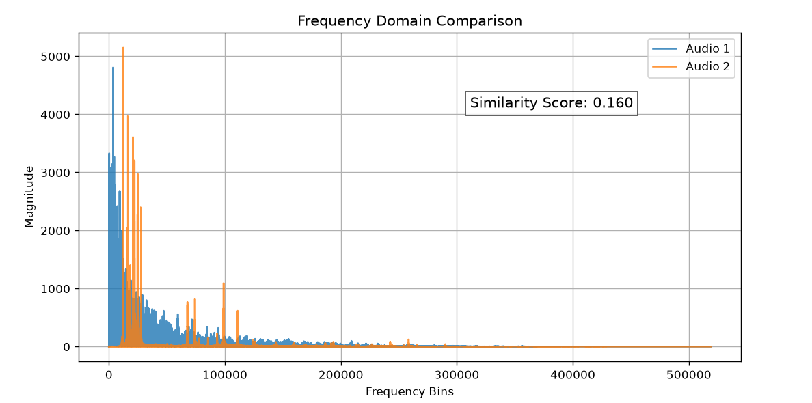

# Audio Frequency Similarity Using FFT and Cosine Similarity

## 📌 Project Overview

This project compares two audio files to measure their similarity using **Fast Fourier Transform (FFT)** and **Cosine Similarity**.

It converts audio signals from the time domain into the frequency domain, extracts their frequency magnitude information, and calculates a similarity score to estimate how closely the two audio files match.

The project also generates a frequency-domain visualization to compare the audio signals graphically.

## 🎯 Objectives

- Analyze and compare two audio files.
- Convert audio signals into the frequency domain using FFT.
- Measure similarity using Cosine Similarity.
- Visualize and compare frequency magnitudes.
- Display a numerical similarity score.

## 🛠️ Technologies Used

- **Python** – Core programming language.
- **Librosa** – Audio loading and resampling.
- **NumPy** – Numerical computations and FFT.
- **Matplotlib** – Frequency-domain visualization.
- **Scikit-learn** – Cosine similarity calculation.

## ⚙️ Project Workflow

1. Load two audio files using Librosa.
2. Resample both audio signals to a common sampling rate.
3. Trim both signals to the same length.
4. Apply Fast Fourier Transform (FFT).
5. Extract the magnitude components of positive frequencies.
6. Calculate similarity using Cosine Similarity.
7. Display the similarity score.
8. Generate a graph comparing both audio signals in the frequency domain.

## 📂 Project Structure

```text
audio-frequency-similarity/
│
├── Audio.py
├── audio21.mpeg
├── audio22.mpeg
├── output.png
├── .gitignore
├── requirements.txt
└── README.md
```

## 📦 Installation

### **1. Clone the Repository**

```bash
git clone https://github.com/Lakshanika1/audio-frequency-similarity.git
```

### **2. Navigate to the Project Directory**

```bash
cd audio-frequency-similarity
```

### **3. Install Required Libraries**

```bash
pip install librosa numpy matplotlib scikit-learn
```

Alternatively, install dependencies using:

```bash
pip install -r requirements.txt
```

## ▶️ How to Run

1. Place two audio files (`audio21.mpeg` and `audio22.mpeg`) inside the project folder.
2. Run the Python script:

```bash
python Audio.py
```

3. View the similarity score in the terminal.
4. Observe the frequency-domain comparison graph.

## 📊 Output

The project produces:

- **Similarity Score:** A numerical value representing the cosine similarity between the two frequency magnitude vectors.
- **Frequency-Domain Graph:** A visual comparison of the frequency components of both audio files.

## 📸 Output Screenshot

The following graph shows the frequency-domain comparison of the two audio files along with their cosine similarity score.



**Sample Similarity Score:** 0.160

### Understanding the Similarity Score

- A score closer to **1** indicates more similar frequency magnitude patterns.
- A score closer to **0** indicates less similar frequency magnitude patterns.
- Since FFT magnitudes are non-negative, cosine similarity generally ranges from 0 to 1.

**Note:** A high similarity score does not necessarily mean that two audio recordings are identical.

## 🧠 Key Concepts

### Fast Fourier Transform (FFT)
Transforms an audio signal from the time domain into the frequency domain, helping analyze its frequency components.

### Cosine Similarity
Measures the cosine of the angle between two frequency magnitude vectors to estimate their similarity.

### Frequency-Domain Analysis
Helps identify and compare the frequency characteristics of two audio signals.

## 🚀 Future Improvements

- Support multiple audio formats.
- Add waveform visualization.
- Implement MFCC-based audio comparison.
- Introduce noise reduction and preprocessing.
- Develop a simple web interface for audio uploads.
- Improve comparison using time-frequency features such as spectrograms.

## 📝 Conclusion

This project demonstrates how FFT and Cosine Similarity can be used
to compare the frequency characteristics of two audio signals.
It provides both a numerical similarity score and a graphical
representation for understanding the comparison.

## 👩‍💻 Author

**Lakshanika**

Computer Science and Engineering Student

## 📄 License

This project is developed for educational and learning purposes.
